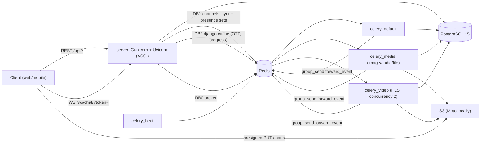
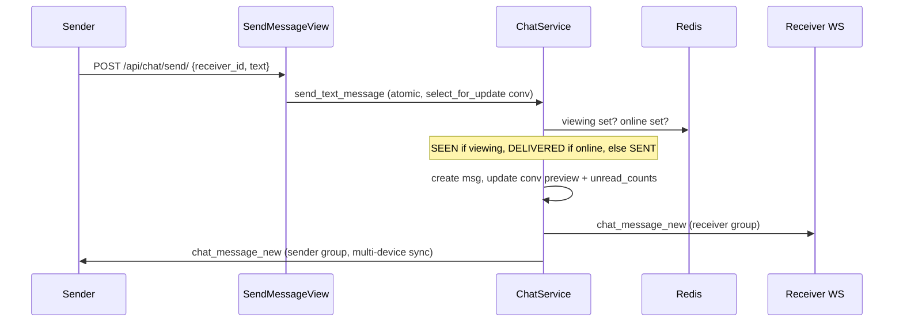
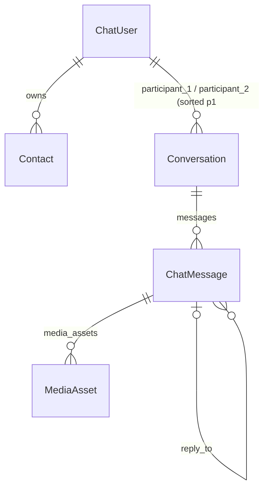

# Pulse Chat — Codebase Analysis

## 1. What this project is

A **1-to-1 real-time chat backend** (no frontend yet) built with Django 6 + DRF + Channels, aimed at being both a production-grade system and a **system-design learning repo**. Key features:

- Passwordless auth: email → OTP → JWT, with tokens **bound to a client** (IP + User-Agent hash)
- Text, image, video, audio, file and album messages
- Direct-to-S3 uploads (presigned PUT or multipart), then async processing in Celery
- Real-time delivery over a single per-user WebSocket: presence, typing, ticks (sent/delivered/seen), media progress
- Reply, forward (bulk, zero-copy S3 reuse), cursor pagination everywhere

## 2. Architecture



| Layer | Location | Role |
| --- | --- | --- |
| Entry | [asgi.py](../server/core/asgi.py) | HTTP → Django, WS → JWT middleware → consumer |
| Auth | [users/views.py](../server/users/views.py), [jwt_util.py](../server/utils/jwt_util.py), [auth_middleware.py](../server/middlewares/auth_middleware.py) | OTP login, client-bound JWT |
| Chat domain | [chats/services.py](../server/chats/services.py) | `ChatService`: send, media init, forward, mark read, broadcast |
| Realtime | [consumers.py](../server/channel/consumers.py) | `UserSocketConsumer`: one group per user `user_{id}` |
| Presence state | [redis_client.py](../server/utils/redis_client.py) | `RedisKeys`, `ChatRedisService` |
| Workers | [chats/tasks.py](../server/background_worker/chats/tasks.py) | media processing, delivery receipts, cleanup |
| Media | [media_processors/](../server/utils/media_processors) | Image→WebP+thumb, Video→HLS+thumb, Audio→AAC+waveform, PDF→thumb |

## 3. Core flows

### 3.1 Login (OTP)
1. `POST /api/auth/register/` → user created, welcome email task
2. `POST /api/auth/send-otp/` → 6-digit OTP cached 5 min, returns a 2-min **email token** (HS256 JWT)
3. `POST /api/auth/verify-otp/` → checks OTP (3-attempt lockout) → issues refresh/access JWT (HS512) with `client_hash`
4. Every HTTP request: `JWTClientBindingMiddleware` rejects tokens whose `client_hash` ≠ current IP+UA

### 3.2 Text message


### 3.3 Media message
1. `POST /send/` with `attachments[]` → message + `MediaAsset(queued)` rows; response contains per-asset upload instructions (`direct` PUT URL if ≤5 MB, else `multipart` with first batch of part URLs). A pending `chat_message_new` is broadcast.
2. Client uploads to S3; for big files calls `POST /sign-batch/` for more part URLs.
3. `POST /complete/` → completes multipart, sets asset `running`, dispatches the task by kind.
4. Worker processes → `_finalize_asset` → `chat_message_update` to sender (and receiver **only if viewing**). Video sends progress every ≥2 % and an early "playable" event; resumes from Redis checkpoints on retry.

### 3.4 Presence, ticks, receipts
| Redis key | Type | Meaning |
| --- | --- | --- |
| `online_users` | set | user IDs with ≥1 socket |
| `user:{id}:connections` | set | channel names (multi-tab/device) |
| `user:{id}:viewing:{peer}` | set | sockets currently showing chat with `peer` (blue ticks) |
| `user:{id}:presence_audience` | set | who should get my online/offline (filled when others load chat list/contacts) |

- First socket connects → `online`, notify audience, run `mark_delivered_and_notify_senders` (SENT→DELIVERED + `chat_delivery_receipt`)
- Opening the message list (first page) → `mark_messages_as_read` → `chat_read_receipt`

### 3.5 WebSocket protocol (current, implicit)
| Direction | `type` | Payload |
| --- | --- | --- |
| C→S | `ping` | — → `pong` |
| C→S | `chat_open` / `chat_close` | `receiver_id` |
| C→S | `chat_typing` | `receiver_id` → forwarded as `chat_typing` |
| S→C | `auth_error` | close code 4002 |
| S→C | `presence_update` | `user_id`, `status` |
| S→C | `chat_message_new` | serialized message |
| S→C | `chat_message_update` | `id`, `status`, `media_assets[]`, optional `progress` |
| S→C | `chat_delivery_receipt` | `conversation_id`, `receiver_id`, `last_delivered_id` |
| S→C | `chat_read_receipt` | `conversation_id`, `reader_id`, `last_read_id` |

> [!NOTE]
> This contract exists only in code. It's the first thing that should become a formal spec, since a frontend and the tests both depend on it.

## 4. Data model

Denormalized on `Conversation`: `last_message_*`, `unread_counts` (JSON `{user_id: n}`). On `ChatMessage`: `asset_count`, `render_cache`, `reply_metadata`.

## 5. Existing AI tooling
There is already a decent **Claude Code** setup: root and server `CLAUDE.md`, 6 skills (`add-endpoint`, `add-celery-task`, `add-test`, `add-ws-event`, `design`, `learn`), 3 review agents and some commands. What's missing:
- Nothing tool-agnostic (`AGENTS.md`), so Antigravity, Cursor, Codex etc. don't get it
- No **specs**, no acceptance criteria, no ADRs: the "why" lives only in commit messages and `server/docs/`
- Some rules no longer match the code (see 6.2)

## 6. Findings

### 6.1 Bugs and risks (confirmed by reading the code)
| # | Severity | Issue | Where |
| --- | --- | --- | --- |
| 1 | 🔴 Critical | `send-otp` **returns the OTP in the response body**, so anyone who knows an email can log in as that user | [views.py:L97-101](../server/users/views.py#L97-L101) |
| 2 | 🔴 High | No default queue set: `send_templated_email_task` and `mark_delivered_and_notify_senders` go to Celery's implicit `celery` queue, which **no worker consumes**, so emails and delivery receipts never run in docker-compose | [celery.py](../server/background_worker/celery.py), [docker-compose.yml](../docker-compose.yml) |
| 3 | 🔴 High | Beat schedule uses the task name `chats.tasks.cleanup_stuck_assets`, but the registered name is `background_worker.chats.tasks.cleanup_stuck_assets`, so cleanup never runs | [celery.py:L30](../server/background_worker/celery.py#L30) |
| 4 | 🟠 High | `sign-batch` has no ownership check, so any logged-in user can get upload URLs for any `object_key`/`upload_id` | [chats/views.py:L149-187](../server/chats/views.py#L149-L187) |
| 5 | 🟠 Medium | Opening a chat with no conversation yet crashes: `get_paginated_response` is called before `paginate_queryset`, so `has_next` is undefined → AttributeError → 500 | [chats/views.py:L267-268](../server/chats/views.py#L267-L268) |
| 6 | 🟠 Medium | The WS middleware is named "ClientBinding" but **doesn't check `client_hash`**; the token also travels in the query string (it shows up in access logs) | [websocket_middleware.py](../server/middlewares/websocket_middleware.py) |
| 7 | 🟡 Medium | `MediaAsset.url` hardcodes the public AWS URL and ignores mock mode (avatars handle it, media doesn't), and assumes a public bucket | [chats/models.py:L143-151](../server/chats/models.py#L143-L151) |
| 8 | 🟡 Medium | Two S3 modules ([aws.py](../server/utils/aws.py) and [s3.py](../server/utils/s3.py)) with different key formats; views use one, services the other, and tests patch only `utils.aws` | utils/ |
| 9 | 🟡 Low | `mark_messages_as_read` does a read-modify-write on `unread_counts` without a row lock (lost updates under concurrency) | services.py |
| 10 | 🟡 Low | `chat_typing` goes to any `receiver_id` with no relationship check | consumers.py |
| 11 | 🟡 Ops | `entrypoint.sh` runs `makemigrations` on boot; `DEBUG=True` and `ALLOWED_HOSTS=*` are hardcoded | entrypoint.sh, settings.py |
| 12 | ⚪ Smell | `PENDING` status is never assigned by services; `processing_progress` is set on a field that no longer exists | tasks.py |

### 6.2 Where the docs and code disagree (AI agents get misled by these)
- `CLAUDE.md` says "no trailing slash"; **every URL has a trailing slash**
- It says "use `ChatRedisService` instead of `group_send`", but `ChatRedisService` has no send methods and services call `group_send` directly
- It says "never call boto3 directly, use `utils/s3.py`", but `utils/aws.py` calls boto3 directly and views use it
- The Celery rules (`soft_time_limit`, `time_limit`) aren't followed by the image, audio and file tasks
- `feature.txt` is an informal TODO list, not a spec

### 6.3 Test-suite health
- 74 tests across 10 files. Collection couldn't run here: Docker is down, and `server/env` has a broken `pytest`.
- Several tests are **stale and will fail on import or assertion**:
  - `test_chat_tasks.py` imports `process_uploaded_asset` / `notify_message_event` (they don't exist)
  - `chats/test_views.py` targets `/api/chat/upload/prepare/` (removed)
  - The WS tests expect `"Authentication failed"` and a `success` key; the consumer sends `"Unauthorized"` with no `success` key
- No tests cover `ChatService` (send, forward, mark-read), `ChatListView`, `ChatMessageListView`, `CompleteUpload` ownership, or the video, audio and file tasks
- CI needs live Postgres and Redis, and there's no coverage gate or lint

## 7. Proposed direction: spec-driven + TDD, readable by any agent (draft)

```text
AGENTS.md                      # single source of truth for ALL agents (Antigravity, Claude, Codex, Cursor…)
CLAUDE.md -> AGENTS.md         # thin pointer / symlink so Claude Code keeps working
.agents/skills/                # tool-agnostic skills (spec-write, spec-implement-tdd, add-endpoint…)
.claude/skills -> .agents/skills
docs/
  architecture/                # overview, data-model, realtime, media-pipeline, auth (from this analysis)
  specs/
    _TEMPLATE.md               # status, context, requirements, acceptance criteria (AC-IDs), API/WS contract, test plan
    auth/  chats/  realtime/  media/  users/
  contracts/
    websocket-events.md        # formal WS protocol (sec. 3.5)
    openapi.json               # generated from drf-yasg
  adr/                         # architecture decision records (why cursor pagination, why per-user groups, …)
  learning/                    # move the existing caching/pagination/celery learning docs here
server/tests/                  # each test docstring references spec AC-IDs, e.g. "AUTH-OTP-003"
```

**Workflow every agent follows:** `Spec (draft → approved)` → `write failing tests mapped to AC-IDs` → `implement until green` → `refactor` → `update spec status + docs`.

**Before adding features, Phase 0 would be:** fix the test baseline (delete or rewrite stale tests, add `fakeredis`, make tests runnable without Docker where possible), then write "as-built" specs for existing behavior so the current code becomes the documented baseline.
