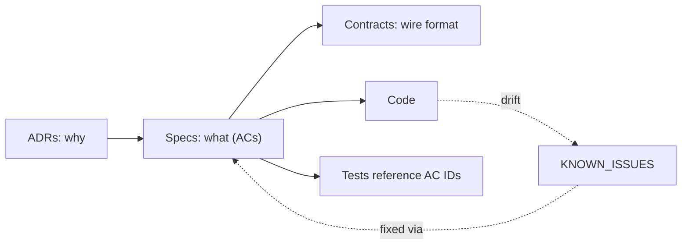

# Pulse Chat Documentation

Start here. This folder is the **source of truth** for what Pulse Chat does and why. It's written for humans and AI agents alike.

| I want to… | Go to |
| --- | --- |
| Understand system architecture & components | [architecture/overview.md](architecture/overview.md) |
| Read relational schema & query patterns | [architecture/data-model.md](architecture/data-model.md) |
| Learn real-time WS & presence mechanics | [architecture/realtime.md](architecture/realtime.md) |
| Inspect cloud media processing pipeline | [architecture/media-pipeline.md](architecture/media-pipeline.md) |
| Check auth & JWT client binding | [architecture/auth.md](architecture/auth.md) |
| View REST API contract & endpoints | [contracts/rest-api.md](contracts/rest-api.md) |
| View WebSocket events & wire protocol | [contracts/websocket-events.md](contracts/websocket-events.md) |
| Understand how a feature must behave | [specs/](specs/README.md) |
| Know why something is built a certain way | [adr/](adr/README.md) |
| See known bugs and spec deviations | [KNOWN_ISSUES.md](KNOWN_ISSUES.md) |
| Read the original codebase analysis | [PROJECT_ANALYSIS.md](PROJECT_ANALYSIS.md) |

## How the pieces fit



- **Specs** define behavior with numbered acceptance criteria (`CHAT-001.AC3`).
- **ADRs** record decisions that constrain the specs.
- **Known issues** track where code currently violates a spec.

## Validation

```bash
python3 .agents/skills/spec-sync/scripts/check_specs.py
```
