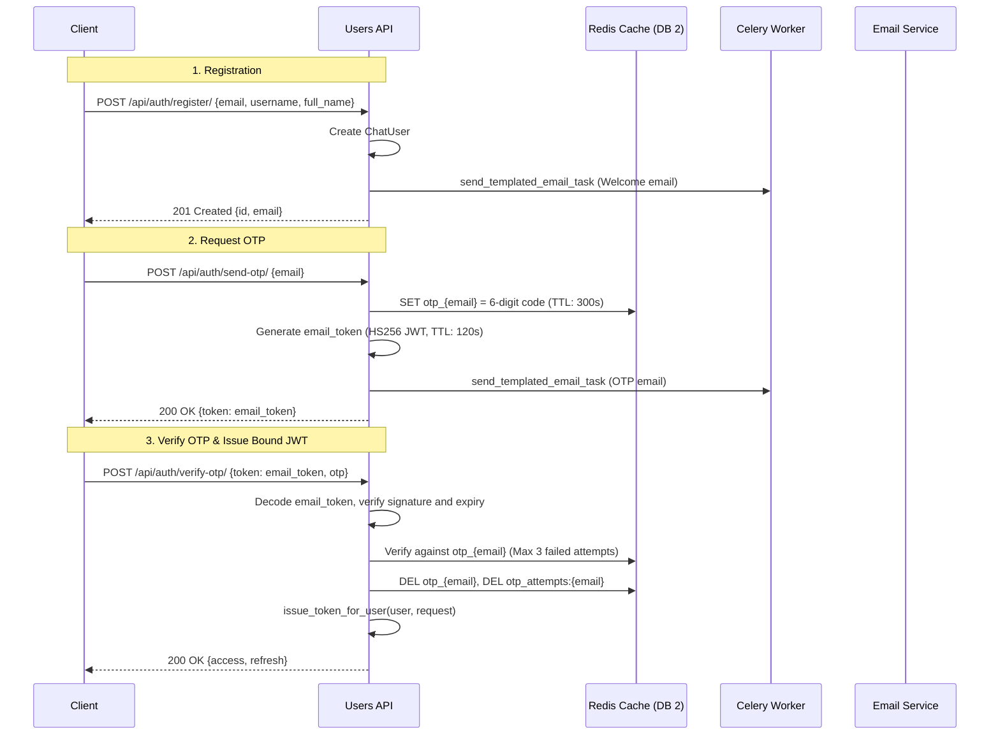

# Authentication & Client Binding Architecture

Pulse Chat implements a passwordless, email-driven authentication workflow based on short-lived one-time passwords (OTP) and **client-bound JWT tokens** signed with HS512.

## Authentication Workflow



---

## Client Signature Binding

To protect users against token theft, tokens are bound to the client's fingerprint at issuance time:

```python
# server/utils/jwt_util.py
def get_client_signature(request) -> str:
    ip = request.META.get('REMOTE_ADDR', '')
    ua = request.META.get('HTTP_USER_AGENT', '')
    return hashlib.sha256(f'{ip}-{ua}'.encode()).hexdigest()
```

1. **At Issuance** (`issue_token_for_user`):
   - Computes SHA-256 of `REMOTE_ADDR` and `HTTP_USER_AGENT`.
   - Embeds claim `client_hash` into both Refresh Token and Access Token.
2. **At Every HTTP Request** (`JWTClientBindingMiddleware`):
   - Extracts Bearer token from `Authorization` header.
   - Computes current request's signature and compares against token's `client_hash`.
   - If mismatched → Returns `403 Forbidden` (`Client mismatch`).
3. **At Token Refresh** (`CustomTokenRefreshView`):
   - Validates client signature on the incoming refresh token before issuing new token pair.

---

## Token Specifications & Lifetimes

- **Access Token**:
  - Lifetime: 15 minutes.
  - Algorithm: `HS512` signed with `DJANGO_SECRET_KEY`.
- **Refresh Token**:
  - Lifetime: 7 days.
  - Rotation: Enabled (`ROTATE_REFRESH_TOKENS = True`).
  - Blacklisting: Enabled on rotation and logout via `rest_framework_simplejwt.token_blacklist`.
- **Email Token**:
  - Short-lived HS256 token (2 minutes) passed from `send-otp` to `verify-otp` to authenticate the email claim without sessions.

---

## Security Mitigations & Known Deviations

| Security Feature | Implementation Details |
| --- | --- |
| Brute-Force Protection | Failed OTP attempts are tracked in `otp_attempts:{email}`. At 3 failures, OTP is deleted and user is locked out (`429 Too Many Requests`). |
| Token Revocation | `LogoutView` immediately adds refresh token to blacklist. |
| **Known Deviation BUG-001** | `SendOTPView` currently echoes OTP in JSON response for test convenience. Must be removed in production hardening. |
| **Known Deviation BUG-006** | WebSocket middleware does not currently enforce the `client_hash` check. |
