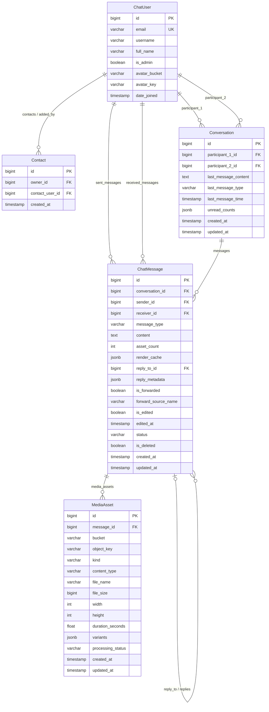

# Data Model Architecture

This document describes the relational database schema, model relationships, indexing strategies, denormalizations, and query patterns in Pulse Chat.

## Entity Relationship Overview

---

## Models & Constraints

### 1. `ChatUser` (`server/users/models.py`)
Custom user model extending `AbstractUser`.
- `email`: Unique identifier (`USERNAME_FIELD = 'email'`).
- `full_name`: User's display name.
- `avatar_bucket`, `avatar_key`: S3 storage pointers for profile avatars.
- Computed Property `avatar_url`: Returns mock URL in `USE_S3_MOCK=True` mode, or public S3 HTTPS link.

### 2. `Contact` (`server/users/models.py`)
Direct address book relationship between two users.
- `owner`: User who added the contact.
- `contact_user`: The user added.
- `unique_together = ('owner', 'contact_user')`: Prevents duplicate entries.

### 3. `Conversation` (`server/chats/models.py`)
Represents a 1-to-1 chat channel between two participants.
- **Pair Invariant**: `participant_1_id < participant_2_id`. The application layer sorts participant IDs upon retrieval and creation (`sorted([p1, p2])`).
- `unique_together = ('participant_1', 'participant_2')`: Enforces strictly one conversation row per participant pair.
- **Denormalized fields** for blazing fast chat list queries without heavy aggregations:
  - `last_message_content`: Short preview (text or emoji-prefixed label like `📷 Photo`).
  - `last_message_type`: Message type enum string.
  - `last_message_time`: Timestamp of latest message.
  - `unread_counts`: JSON object mapping string user IDs to unread integer counts, e.g., `{"101": 0, "102": 3}`.
- **Indexes**:
  - `Index(participant_1, -updated_at)`
  - `Index(participant_2, -updated_at)`

### 4. `ChatMessage` (`server/chats/models.py`)
Individual message sent inside a conversation.
- `conversation`: Foreign key to `Conversation`.
- `sender`, `receiver`: Foreign keys to `ChatUser`.
- `message_type`: Choices: `text`, `image`, `video`, `audio`, `file`, `album`.
- `status`: Choices: `pending`, `sent`, `delivered`, `seen`, `failed`.
- `asset_count`: Total attached assets (avoids JOIN count query when rendering chat bubbles).
- `reply_to`: Foreign key self-reference (nullable) for relational consistency.
- `reply_metadata`: JSON snapshot of parent sender name and text preview (avoids query traversal when rendering reply cards).
- `is_forwarded`, `forward_source_name`: Forwarding flags.
- **Indexes**:
  - `Index(conversation, -created_at)`: Primary pagination index for message history.
  - `db_index=True` on `created_at`, `status`.

### 5. `MediaAsset` (`server/chats/models.py`)
Attached media file linked to a `ChatMessage`.
- `kind`: `image`, `video`, `audio`, `file`.
- `bucket`, `object_key`: S3 bucket and object key path.
- `processing_status`: `queued`, `running`, `done`, `failed`.
- `variants`: JSON metadata storing derivative outputs:
  - Video: HLS master playlist key, thumbnail key, segmented variant status.
  - Audio: AAC m4a key, waveform bar heights list (`waveform: [int]`).
  - Image: WebP optimized image key, thumbnail key, dimensions.
  - PDF: Thumbnail image key, page count.

---

## Query Patterns & Index Optimization

1. **User's Conversations List (`ChatListView`)**:
   Query filters `Q(participant_1=uid) | Q(participant_2=uid)` and orders by `-updated_at`.
   Supported directly by compound indexes `(participant_1, -updated_at)` and `(participant_2, -updated_at)`.
2. **Conversation History (`ChatMessageListView`)**:
   Query filters `conversation=conv` and orders by `-created_at`.
   Supported by compound index `(conversation, -created_at)`.
3. **Cursor-based Pagination**:
   Never uses `OFFSET` / `LIMIT`. All pagination encodes cursor positions on indexed timestamps (`-updated_at` or `-created_at`).
