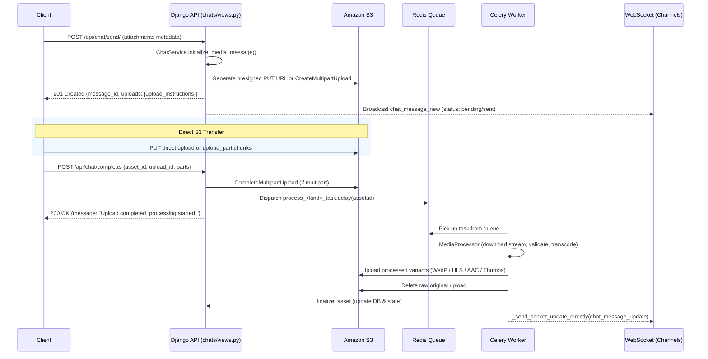

# Media Processing Pipeline Architecture

Pulse Chat implements a **direct-to-cloud upload pattern**: clients stream bytes directly to Amazon S3 (or local Moto mock) via presigned URLs. The Django application server never buffers upload byte streams in memory, reserving its workers for API orchestration and WebSocket dispatch.

## End-to-End Upload Workflow

---

## 1. Direct vs Multipart Upload Strategy

- **Threshold**: 5 MB (`DIRECT_THRESHOLD = 5 * 1024 * 1024`).
- **Files ≤ 5 MB**:
  - `mode: "direct"`.
  - Generates a single presigned `put_object` URL (valid for 5 minutes).
- **Files > 5 MB**:
  - `mode: "multipart"`.
  - Calls `s3.create_multipart_upload`.
  - Batches presigned `upload_part` URLs (up to 100 parts per batch, cap of 500).
  - Additional part URLs can be requested via `POST /api/chat/sign-batch/`.

---

## 2. Queue Isolation & Worker Allocation

To prevent resource starvation (e.g., intensive video encoding starving real-time tasks), Celery queues are isolated across specialized worker containers:

| Queue Name | Worker Container | Concurrency | Task Handlers | Processing Type |
| --- | --- | --- | --- | --- |
| `video_queue` | `celery_video` | 2 (isolated) | `process_video_task` | CPU/RAM intensive FFmpeg transcoding |
| `image_queue` | `celery_media` | 4 | `process_image_task` | Pillow downsampling & WebP conversion |
| `audio_queue` | `celery_media` | 4 | `process_audio_task` | AAC conversion & waveform peak extraction |
| `file_queue` | `celery_media` | 4 | `process_file_task` | PDF thumbnail rendering (pdf2image) |
| `default` | `celery_default`| 4 | `send_templated_email_task`, `cleanup_stuck_assets` | Low-latency I/O tasks |

---

## 3. Media Processors (`server/utils/media_processors/`)

### ImageProcessor (`image.py`)
- Reads remote header / first 2KB for magic bytes validation (`libmagic`).
- Enforces max dimensions to guard against decompression bombs.
- Performs EXIF auto-rotation (`ImageOps.exif_transpose`).
- Generates:
  1. Primary WebP image (max 1920px boundary, quality 80).
  2. Thumbnail WebP image (max 300px boundary).
- Deletes the original unoptimized upload from S3 upon completion.

### VideoProcessor (`video.py`)
- Streams directly from presigned S3 GET URL via FFmpeg.
- Checks magic bytes and runs `ffmpeg.probe` for stream integrity.
- Extracts early video thumbnail at timestamp 1s (or 0s).
- **HLS Multi-Bitrate Transcoding**:
  - Downsamples to applicable resolution ladder (`1080p`, `720p`, `480p`, `360p`, `240p`).
  - Emits real-time progress callbacks to WebSocket via `FFmpegProgressTracker`.
  - **Early Playable Trigger**: When the lowest variant finishes encoding, emits `on_playable` event with `master.m3u8` so the recipient can begin streaming immediately while higher variants finish.
  - **Checkpointing**: Stores variant progress in Redis (`video_checkpoint:{asset_id}`) enabling automatic resume if interrupted.

### AudioProcessor (`audio.py`)
- Performs parallel MIME type validation and duration probing.
- **Single-Pass Audio Pipeline**:
  - Encodes output audio stream to AAC/M4A (`movflags=+faststart`).
  - Concurrently branches PCM audio stream (`s16le`, 8kHz) to compute 50 waveform peak values (`numpy`).
- Waveform list is stored in `variants.waveform` for visual audio player rendering.

### FileProcessor (`file.py`)
- Checks magic bytes on the first 2KB without downloading the full document.
- For PDFs under 50 MB: renders page 1 at 75 DPI to generate a 500px JPEG thumbnail and extracts page count.

---

## 4. Finalization & Stuck Asset Sweeping

- **Finalization (`_finalize_asset`)**:
  - Updates `MediaAsset` to status `done`, records dimensions, sizes, and variant URLs.
  - Pushes `chat_message_update` directly to the Channels layer bypassing Celery queues for zero latency.
- **Hourly Beat Sweeper (`cleanup_stuck_assets`)**:
  - Celery Beat scheduled task sweeping `queued` assets older than 24h and `running` assets older than 2h.
  - Marks abandoned assets as `failed` and notifies active chat participants.
