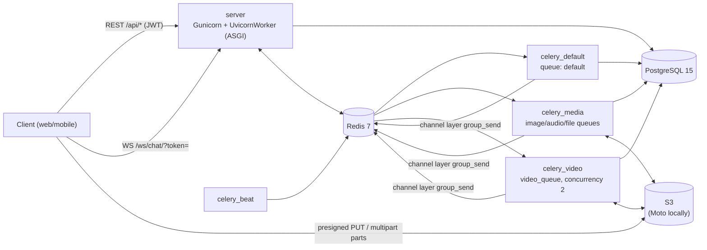
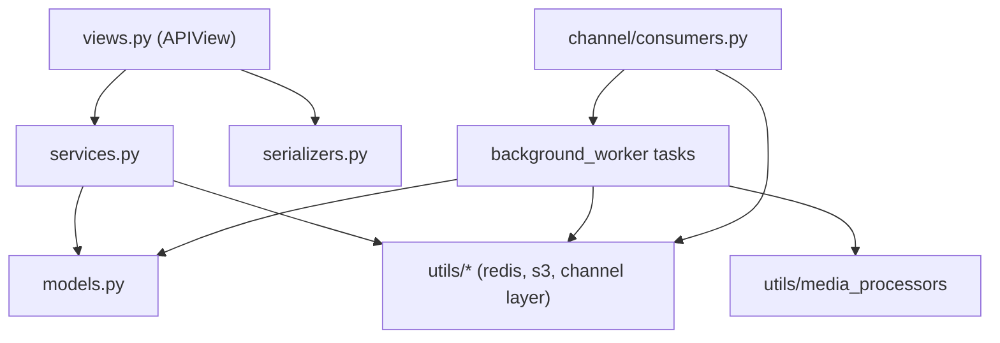

# Architecture Overview

Pulse Chat is a **1-to-1 real-time chat backend**: Django 6 + DRF for REST, Django Channels for WebSocket push, Celery for async media processing, PostgreSQL for data, Redis for everything ephemeral, and S3 for files. There is no frontend in this repo yet.

## System context

## Redis usage

One Redis instance with three logical DBs:

| DB | Env var | Used by | Contents |
| --- | --- | --- | --- |
| 0 | `CELERY_BROKER_URL` | Celery | task queues + results |
| 1 | `CHANNEL_URL` | Channels layer **and** `utils/redis_client.py` | channel groups; presence/viewing/audience sets (see [realtime.md](realtime.md)) |
| 2 | `CACHE_URL` | Django cache | OTP codes and attempts, pending avatar keys, media progress and video checkpoints |

## Code map (`server/`)

| Package | Responsibility | Key modules |
| --- | --- | --- |
| `core/` | settings, URL root, ASGI/WSGI, Celery app import | `settings.py`, `asgi.py`, `urls.py` |
| `users/` | registration, OTP login, tokens, profile, contacts, avatar | `views.py`, `services.py` (`AvatarService`), `serializers.py` |
| `chats/` | conversations, messages, media assets, uploads | `services.py` (`ChatService`), `views.py`, `serializers.py`, `pagination.py` |
| `channel/` | WebSocket consumer + routing | `consumers.py` (`UserSocketConsumer`), `routing.py` |
| `background_worker/` | Celery app, queues, routes, beat; task modules | `celery.py`, `chats/tasks.py`, `users/tasks.py` |
| `middlewares/` | HTTP JWT client binding, WS JWT auth, DRF exception handler | `auth_middleware.py`, `websocket_middleware.py`, `exception_handler.py` |
| `utils/` | shared infrastructure | `response.py`, `pagination.py`, `redis_client.py`, `jwt_util.py`, `auth_util.py`, `s3.py`, `aws.py`, `media_processors/` |
| `templates/emails/` | OTP + welcome emails (HTML + text) | |
| `tests/` | pytest suite (being reworked in the TDD phase) | `conftest.py`, `constants.py` |

## Layering rules

- Views validate input with serializers, call services, and shape the response with `success_response` / `error_response`.
- Services own transactions, state changes, and WebSocket broadcasts.
- Tasks receive **IDs**, never model instances.
- Known exceptions in the current code are tracked in [KNOWN_ISSUES.md](../KNOWN_ISSUES.md). For example, `ChatListView` and `ChatMessageListView` still hold query logic.

## Request lifecycles

**REST:** `JWTClientBindingMiddleware` (reject tokens that don't match the client) → DRF `JWTAuthentication` → `APIView` → service → `success_response`/`error_response`. Unhandled exceptions are turned into the error envelope by `custom_exception_handler`.

**WebSocket:** `ProtocolTypeRouter` → `JWTClientBindingASGIMiddleware` (token from `?token=`) → `URLRouter` → `UserSocketConsumer`. Details: [realtime.md](realtime.md), contract: [websocket-events.md](../contracts/websocket-events.md).

## Runtime services (docker-compose)

| Service | Image | Command / notes |
| --- | --- | --- |
| `db` | `database/Dockerfile` (Postgres 15) | data in `database/db_data` |
| `redis` | `redis:7-alpine` | |
| `s3mock` | `motoserver/moto` | port 5000; buckets are lost on restart and re-created at import of `utils/s3.py` / `utils/aws.py` |
| `server` | `server/Dockerfile` | `entrypoint.sh` (wait for DB, migrate) → `gunicorn core.asgi:application -w 4 -k uvicorn.workers.UvicornWorker` |
| `celery_default` | `server` | `-Q default --concurrency=4` |
| `celery_media` | `server` | `-Q image_queue,audio_queue,file_queue --concurrency=4` |
| `celery_video` | `server` | `-Q video_queue --concurrency=2` |
| `celery_beat` | `server` | `celery -A core beat` |

## Configuration (environment)

All services read `.env` at the repo root through the `x-app-env` anchor in `docker-compose.yml`.

| Variable | Purpose |
| --- | --- |
| `DJANGO_SECRET_KEY` | Django secret; also signs JWTs (HS512) and email tokens (HS256) |
| `POSTGRES_USER`, `POSTGRES_PASSWORD`, `POSTGRES_DB` | mapped to `DATABASE_USER/PASSWORD/NAME` |
| `DATABASE_HOST`, `DATABASE_PORT` | Postgres location (compose sets `db:5432`) |
| `CELERY_BROKER_URL`, `CHANNEL_URL`, `CACHE_URL` | Redis DB 0 / 1 / 2 |
| `EMAIL_HOST_PASSWORD` | SMTP password (Gmail SMTP; sender is hardcoded, see BUG-011) |
| `USE_S3_MOCK`, `AWS_S3_ENDPOINT_URL` | enable Moto and its endpoint |
| `AWS_ACCESS_KEY_ID`, `AWS_SECRET_ACCESS_KEY`, `AWS_S3_REGION_NAME`, `AWS_STORAGE_BUCKET_NAME` | S3 credentials and bucket |
| `DJANGO_DEBUG` | passed by compose but **not read** by settings (BUG-011) |

## Related

- Data model: [data-model.md](data-model.md)
- Realtime, presence, and ticks: [realtime.md](realtime.md)
- Upload and media processing: [media-pipeline.md](media-pipeline.md)
- Authentication: [auth.md](auth.md)
- Contracts: [rest-api.md](../contracts/rest-api.md), [websocket-events.md](../contracts/websocket-events.md)
