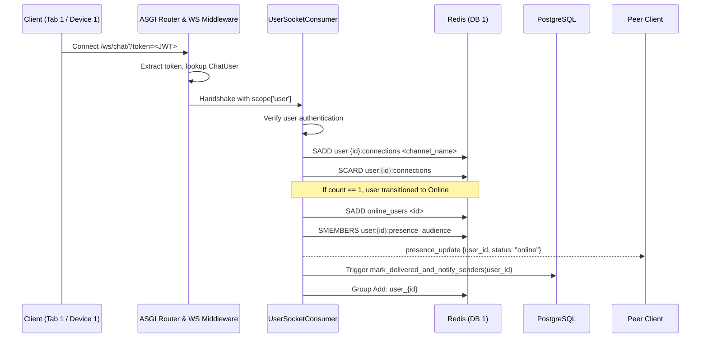
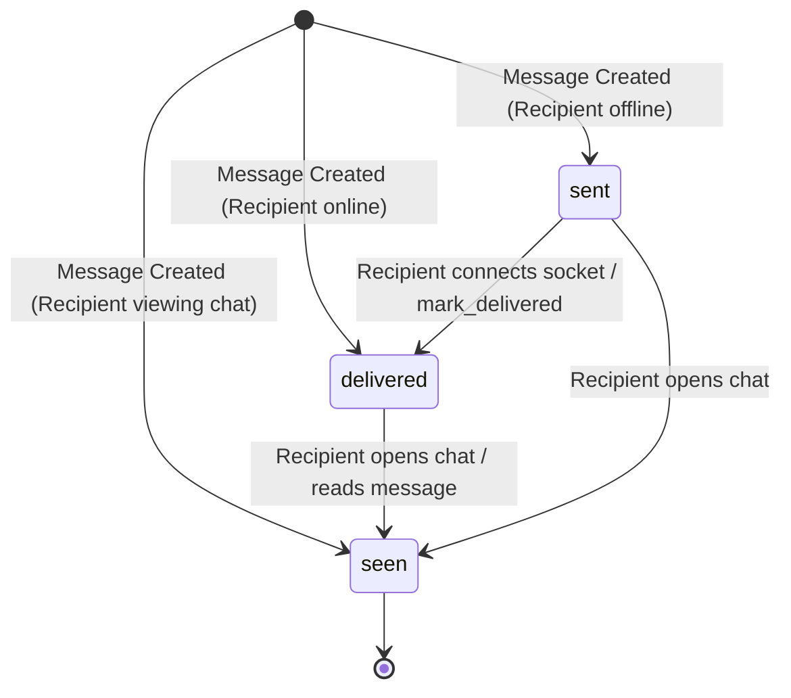

# Real-Time Architecture & Presence

Pulse Chat uses **Django Channels** and **Redis** to deliver real-time WebSocket messaging, presence awareness, multi-device synchronization, and read/delivery receipts.

## Connection Architecture

### Channel Layer Groups
- Every user belongs to their own dedicated room group: `user_{user_id}`.
- Messages, receipts, and system events sent to a user are broadcast to `user_{user_id}`.
- If a user has multiple active browser tabs or mobile devices, each tab has its own `channel_name` registered in `user_{user_id}`. This provides **instant multi-device sync** without multi-group management.

---

## Redis Data Structures (`DB 1`)

All ephemeral real-time state is managed via `utils/redis_client.py` and key templates in `RedisKeys`:

| Key Template | Type | Purpose | TTL |
| --- | --- | --- | --- |
| `online_users` | Set | Set of user IDs currently possessing ≥1 active socket. | Persistent |
| `user:{id}:connections` | Set | Set of active socket `channel_name` identifiers for this user. | Deleted when empty |
| `user:{id}:viewing:{target_id}` | Set | Set of socket `channel_name`s where user `{id}` currently has chat `{target_id}` open. | 24 hours |
| `user:{target_id}:presence_audience` | Set | Set of observer user IDs subscribed to `{target_id}`'s presence changes. | 7 days |

---

## Message Status Lifecycle & Tick System

### 1. Initial Status Calculation (`ChatService._determine_initial_status`)
When a message is sent via REST:
1. Check `user:{receiver}:viewing:{sender}`:
   - If `scard > 0` → Recipient is actively looking at this chat.
   - Status becomes `seen` (Blue Ticks).
2. Otherwise, check `online_users`:
   - If recipient ID is member → Recipient is online.
   - Status becomes `delivered` (Double Grey Ticks).
3. If neither:
   - Status is `sent` (Single Grey Tick).

### 2. Delivery Receipts on Connect (`mark_delivered_and_notify_senders`)
When a user opens their connection:
1. Celery task checks all unread messages where `receiver_id = user_id` and `status = sent`.
2. Updates their database status in bulk to `delivered`.
3. Dispatches `chat_delivery_receipt` event over Channels to each unique sender's group `user_{sender_id}` with `last_delivered_id`.

### 3. Read Receipts (`mark_messages_as_read`)
Triggered when a user opens a chat view or retrieves the first page of message history:
1. Resets `unread_counts[reader_id] = 0` on `Conversation`.
2. Updates all messages from `partner_id` where `id <= latest_message_id` and `status IN ('sent', 'delivered')` to `seen`.
3. Dispatches `chat_read_receipt` to `user_{partner_id}` with `last_read_id`.

---

## Presence Subscription Model (Audience Tracking)

Rather than broadcasting online/offline changes to the entire user base (O(N) fan-out):
- When User A fetches their conversation list (`ChatListView`) or contacts list (`GetContactsView`), User A is added to the `presence_audience` set of all partner user IDs.
- When User B connects or disconnects, User B reads `user:{B}:presence_audience` and emits `presence_update` only to those interested observers.
