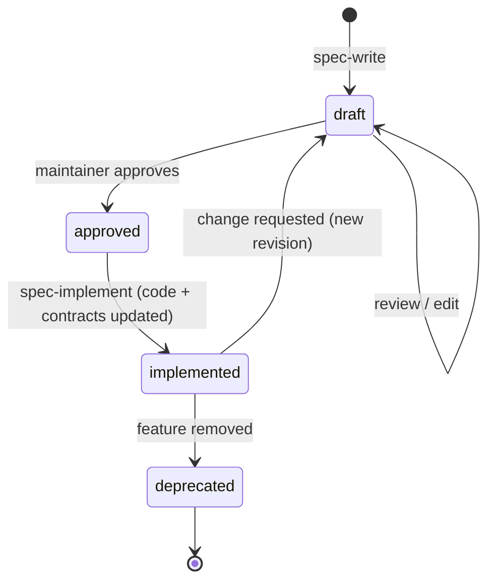

# Specifications

Specs are the **source of truth for behavior** in Pulse Chat. Code implements specs; tests verify specs. When code and spec disagree, the disagreement is either a bug (log it in [KNOWN_ISSUES.md](../KNOWN_ISSUES.md)) or the spec must be updated through the normal lifecycle.

## Golden rules (humans and AI agents)

1. **Read before you change.** Before changing behavior, find the spec that governs the code (`code:` list in frontmatter) and read it.
2. **No behavior change without an `approved` spec.** Refactors that keep behavior identical don't need a spec change, but they must keep `code:` paths valid.
3. **Agents never self-approve.** An agent may write or edit `draft` specs. Only the maintainer approves. An agent may set `status: approved` **only after the maintainer explicitly says so in the conversation**, and must record that in the spec changelog.
4. **Same change, same commit.** Code, spec status, contracts ([websocket-events.md](../contracts/websocket-events.md), [rest-api.md](../contracts/rest-api.md)), and `last_verified` are updated together.
5. **Validate.** Run `python3 .agents/skills/spec-sync/scripts/check_specs.py` before committing.

## Lifecycle

| Status | Meaning | Who sets it |
| --- | --- | --- |
| `draft` | Proposed; may change freely | Anyone / agent |
| `approved` | Agreed; implementation may start | Maintainer (or agent on explicit maintainer instruction) |
| `implemented` | Code matches the spec (except listed known deviations) | Implementer after verification |
| `deprecated` | Behavior removed or superseded | Maintainer |

**Changing an implemented feature:** bump the spec back to `draft`, edit it, and record the reason in the changelog. Once it's approved again, implement it and set it back to `implemented`.

## IDs

| Thing | Format | Example |
| --- | --- | --- |
| Spec | `<AREA>-<NNN>` | `CHAT-001` |
| Acceptance criterion | `<SPEC>.AC<n>` | `CHAT-001.AC3` |
| Known issue | `BUG-<NNN>` | `BUG-004` |
| Decision record | `ADR-<NNNN>` | `ADR-0003` |

Areas: `AUTH` (authentication), `USR` (users, contacts, avatar), `CHAT` (conversations, messages), `RT` (realtime/WebSocket), `MEDIA` (upload processing), `OPS` (infra, deployment, tooling).

- IDs are **never reused**. Deprecated specs keep their ID.
- File name: `docs/specs/<area>/<ID>-<kebab-title>.md`.
- Acceptance criteria are written as `- **AC<n>** Given … When … Then …`. Don't renumber existing ACs; append new ones. Mark removed ones ~~struck through~~ with a note.
- In tests (TDD phase), reference ACs in the docstring: `"""CHAT-001.AC3"""`.

## Writing a spec

Use the [template](_TEMPLATE.md) or the `spec-write` skill (`.agents/skills/spec-write/SKILL.md`). A good spec:

- describes **observable behavior** (API responses, WS events, DB state, side effects), not implementation trivia
- has ACs that are each independently testable
- lists every file it governs in `code:` so agents can find it from the code side
- links the relevant contracts and ADRs

**As-built specs** document existing behavior. If current behavior is wrong, the AC describes the **correct** behavior, and the gap is listed under *Known deviations* with a `BUG-xxx` link, so the TDD phase can turn each deviation into a failing test.

## Index

<!-- Keep this table in sync with the files in this directory. check_specs.py verifies it. -->

| ID | Title | Status | Area |
| --- | --- | --- | --- |
