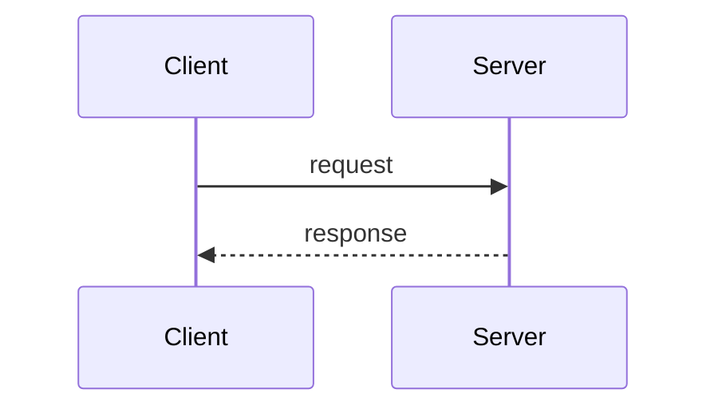

# AREA-000 — Short imperative title

## 1. Summary

One paragraph describing the user-visible behavior.

## 2. Context

Why this exists. Which problem it solves. Links to related specs.

## 3. Scope

**In scope**
- …

**Out of scope**
- …

## 4. Behavior

Rules, state transitions, and flows. Use a sequence or state diagram when the flow crosses components.

## 5. Interface

### REST
`METHOD /api/...` — request fields, response `data` shape, status codes. Full envelope in [rest-api.md](../../contracts/rest-api.md).

### WebSocket
Events emitted or consumed. See [websocket-events.md](../../contracts/websocket-events.md).

### State
Models/fields written, Redis keys (`RedisKeys.*`), cache keys, Celery tasks dispatched.

## 6. Acceptance criteria

- **AC1** Given …, when …, then ….
- **AC2** Given …, when …, then ….

## 7. Non-functional requirements

Performance, limits, security, idempotency, concurrency.

## 8. Known deviations

Current code differs from the ACs above in these ways (fix in the TDD phase):

- None.

## 9. Open questions

- None.

## 10. Changelog

| Date | Change | By |
| --- | --- | --- |
| YYYY-MM-DD | Created | name |
