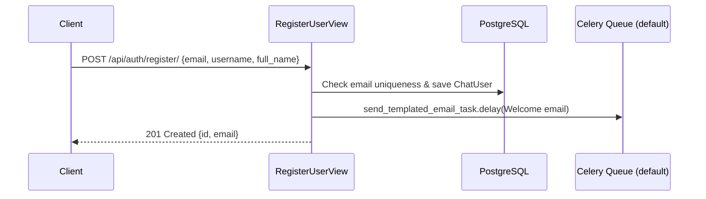

# AUTH-001 — User Registration

## 1. Summary
Allows a new user to register with their unique email, username, and full name. Upon successful account creation, an asynchronous welcome email task is queued via Celery.

## 2. Context
Pulse Chat requires an identity profile for participants before sending messages or establishing real-time connections. Users register once and subsequently log in passwordlessly via email OTP (see [AUTH-002](AUTH-002-otp-login.md)).

## 3. Scope
**In scope**
- Creation of `ChatUser` records with unique email addresses.
- Basic field validations (email format, duplicate checks).
- Asynchronous dispatch of welcome email via Celery task.

**Out of scope**
- Immediate JWT issuance upon registration (users verify OTP to receive tokens).
- Social OAuth / SSO.

## 4. Behavior


## 5. Interface
- **Endpoint**: `POST /api/auth/register/` (unauthenticated)
- **Request Body**:
  ```json
  {
    "email": "user@example.com",
    "username": "johndoe",
    "full_name": "John Doe"
  }
  ```
- **Response**: HTTP 201 Created
  ```json
  {
    "success": true,
    "message": "User registered",
    "data": {
      "id": 105,
      "email": "user@example.com"
    }
  }
  ```

## 6. Acceptance criteria
- **AC1** Given a payload with unique email, username, and full name, when `POST /api/auth/register/` is called, then a `ChatUser` row is created and HTTP 201 is returned.
- **AC2** Given an email already registered in the system, when `POST /api/auth/register/` is called, then HTTP 400 is returned with field error on `email`.
- **AC3** Given missing or invalid email format, when `POST /api/auth/register/` is called, then HTTP 400 is returned with descriptive error messages.
- **AC4** Given successful user creation, then `send_templated_email_task.delay()` is invoked with template `"emails/welcome_email.html"`.

## 7. Non-functional requirements
- Email uniqueness is enforced at database level via unique constraint on `ChatUser.email`.

## 8. Known deviations
- BUG-002: `send_templated_email_task` lacks an explicit queue and Celery lacks `task_default_queue`, routing it to unconsumed `celery` queue in docker-compose.

## 9. Open questions
- None.

## 10. Changelog
| Date | Change | By |
| --- | --- | --- |
| 2026-10-21 | Initial as-built specification | Antigravity |
