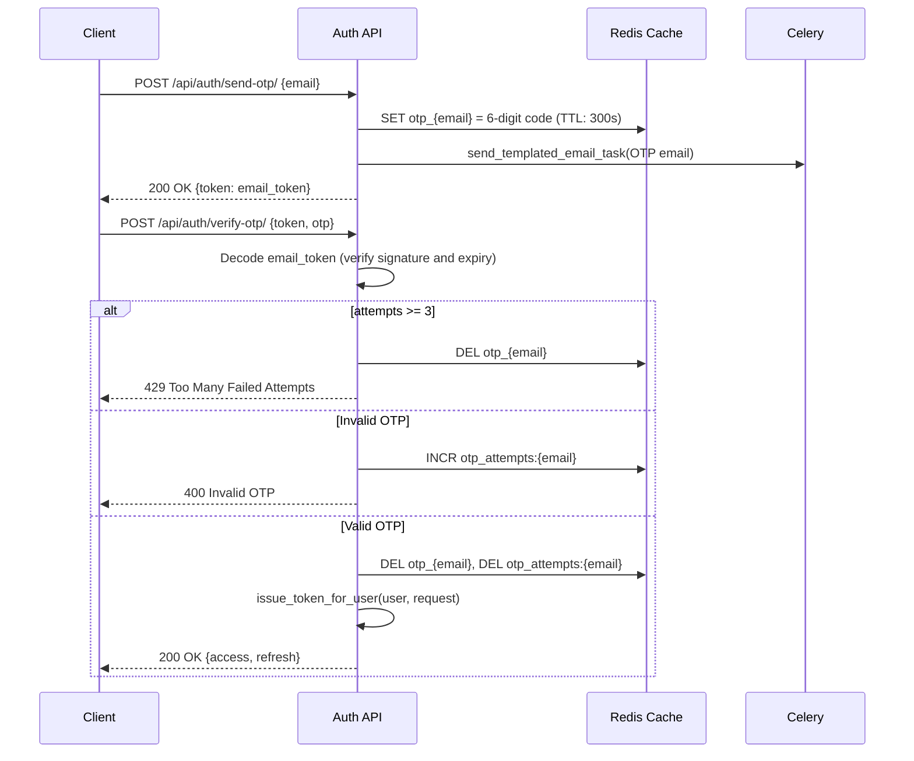

# AUTH-002 — Passwordless OTP Login

## 1. Summary
Authenticates registered users via a 6-digit One-Time Password (OTP) delivered to their verified email address. Verification issues client-bound JWT tokens.

## 2. Context
Eliminates password storage and credential exposure risks while ensuring account access requires control over the registered email mailbox.

## 3. Scope
**In scope**
- Generating cryptographically secure 6-digit OTP code cached in Redis with a 300s TTL.
- Generating a tamper-evident 120s email token (HS256) returned to the client to bind the verification request.
- Enforcing brute-force lockout: max 3 failed verification attempts before invalidating the OTP.
- Issuing client-bound JWT access and refresh tokens upon successful verification.

**Out of scope**
- SMS or authenticator app (TOTP) delivery.

## 4. Behavior

## 5. Interface
- **Send OTP**: `POST /api/auth/send-otp/`
  - Body: `{"email": "user@example.com"}`
  - Response: `{"token": "<email_jwt>"}`
- **Verify OTP**: `POST /api/auth/verify-otp/`
  - Body: `{"token": "<email_jwt>", "otp": "123456"}`
  - Response: `{"access": "<jwt>", "refresh": "<jwt>"}`

## 6. Acceptance criteria
- **AC1** Given a registered email, when `send-otp` is called, a 6-digit numeric OTP is stored in cache (`otp_{email}`) for 300 seconds and an email task is queued.
- **AC2** Given a registered email, when `send-otp` is called, an email token signed with HS256 containing `{"email": email, "exp": now + 2m}` is returned in the response payload.
- **AC3** Given an unregistered email, when `send-otp` is called, HTTP 404 is returned with error message `"No user found with this email"`.
- **AC4** Given a valid email token and matching OTP, when `verify-otp` is called, then the cached OTP and attempts counter are deleted, and bound `access` and `refresh` tokens are returned with HTTP 200.
- **AC5** Given a valid email token and incorrect OTP, when `verify-otp` is called, then `otp_attempts:{email}` is incremented and HTTP 400 is returned.
- **AC6** Given 3 failed OTP attempts for an email, when `verify-otp` is called, the cached OTP is deleted and HTTP 429 is returned.
- **AC7** Given an expired email token (> 2 minutes old), when `verify-otp` is called, HTTP 401 is returned with error message `"Token expired"`.

## 7. Non-functional requirements
- OTP is generated via `secrets.randbelow(900000) + 100000` to prevent pseudo-random predictability.

## 8. Known deviations
- BUG-001: `send-otp` currently includes `"otp": otp` in the JSON response body.
- BUG-002: Email delivery task lacks an explicit queue and is not consumed in standard docker-compose worker configurations.

## 9. Open questions
- None.

## 10. Changelog
| Date | Change | By |
| --- | --- | --- |
| 2026-10-21 | Initial as-built specification | Antigravity |
