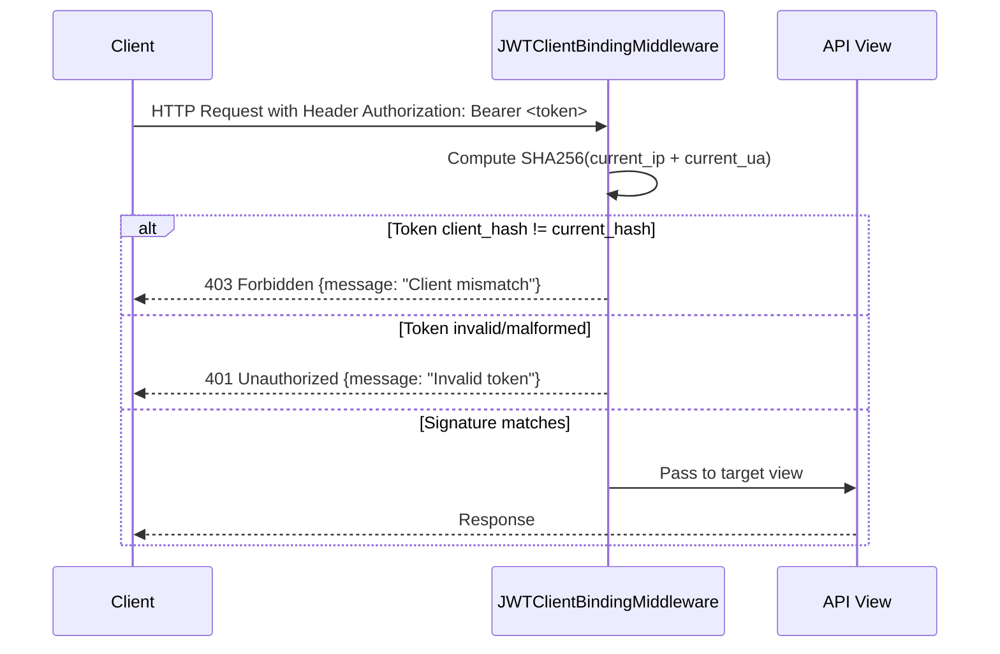

# AUTH-003 — Client-Bound JWT Tokens & Refresh

## 1. Summary
Secures API requests by binding JWT access and refresh tokens to the issuing client's IP address and User-Agent fingerprint. Middleware blocks hijacked or mismatched tokens.

## 2. Context
Standard bearer tokens can be used by an attacker anywhere if intercepted. Binding tokens to a client signature restricts token usability to the originating client device and IP.

## 3. Scope
**In scope**
- Calculating SHA-256 client hash from `REMOTE_ADDR` and `HTTP_USER_AGENT`.
- Embedding `client_hash` claim in both Access and Refresh tokens.
- `JWTClientBindingMiddleware` validation on every HTTP request presenting a Bearer token.
- `CustomTokenRefreshView` validating the refresh token's client signature and issuing a new token pair.

**Out of scope**
- TLS-level client certificates (mTLS).

## 4. Behavior


## 5. Interface
- **Refresh Endpoint**: `POST /api/auth/refresh-token/`
  - Body: `{"refresh": "<refresh_jwt>"}`
  - Response (200 OK):
    ```json
    {
      "success": true,
      "message": "Token refreshed",
      "data": {
        "access": "<new_access_jwt>",
        "refresh": "<new_refresh_jwt>"
      }
    }
    ```

## 6. Acceptance criteria
- **AC1** Given a user and HTTP request, when `issue_token_for_user()` is called, then both access and refresh tokens contain claim `client_hash = SHA256(ip + "-" + user_agent)`.
- **AC2** Given an HTTP request with `Authorization: Bearer <token>` where the client IP or User-Agent differs from issuance time, `JWTClientBindingMiddleware` immediately halts processing and returns HTTP 403 with `"Client mismatch"`.
- **AC3** Given a malformed or expired access token in the Authorization header, `JWTClientBindingMiddleware` returns HTTP 401 `"Invalid token"`.
- **AC4** Given an unauthenticated request (no `Authorization` header), `JWTClientBindingMiddleware` passes the request through without error.
- **AC5** Given a valid refresh token matching the caller's client signature, when calling `POST /api/auth/refresh-token/`, new access and rotated refresh tokens are returned with HTTP 200.
- **AC6** Given a refresh token originating from a different client signature, `POST /api/auth/refresh-token/` returns HTTP 403 with error `"Token does not match client signature"`.

## 7. Non-functional requirements
- Tokens are signed with algorithm `HS512` with a 30-second leeway window.
- Access token lifetime: 15 minutes. Refresh token lifetime: 7 days.

## 8. Known deviations
- BUG-006: WebSocket middleware (`JWTClientBindingASGIMiddleware`) extracts the user from the token but does not execute the `client_hash` verification.

## 9. Open questions
- None.

## 10. Changelog
| Date | Change | By |
| --- | --- | --- |
| 2026-10-21 | Initial as-built specification | Antigravity |
