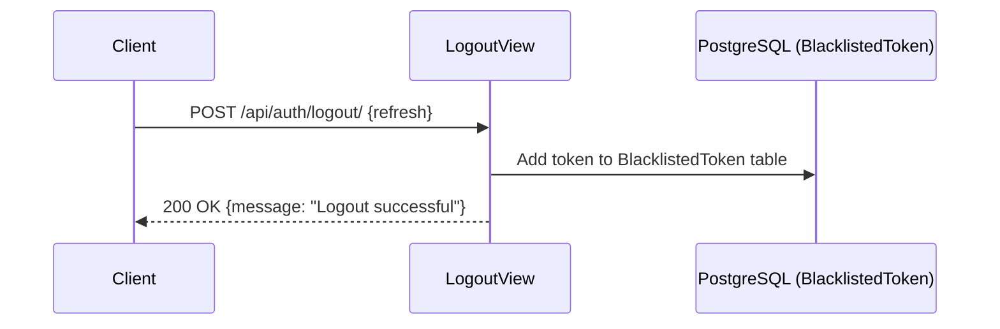

# AUTH-004 — User Logout & Token Blacklisting

## 1. Summary
Logs out an authenticated user by revoking and blacklisting their refresh token in PostgreSQL via `rest_framework_simplejwt.token_blacklist`.

## 2. Context
While access tokens expire in 15 minutes, refresh tokens persist for 7 days. Explicit user logout must permanently invalidate the refresh token so it cannot be used to generate further access tokens.

## 3. Scope
**In scope**
- Requiring authentication (`permission_classes = [IsAuthenticated]`).
- Blacklisting the provided refresh token.

**Out of scope**
- Instant revocation of already issued, unexpired 15-minute access tokens (client discards access token from memory).

## 4. Behavior


## 5. Interface
- **Endpoint**: `POST /api/auth/logout/` (Authenticated)
- **Request Body**:
  ```json
  {
    "refresh": "<refresh_jwt_string>"
  }
  ```
- **Response**: HTTP 200 OK
  ```json
  {
    "success": true,
    "message": "Logout successful",
    "data": null
  }
  ```

## 6. Acceptance criteria
- **AC1** Given an authenticated user and valid refresh token, when `POST /api/auth/logout/` is called, the token is recorded in the blacklist and HTTP 200 is returned.
- **AC2** Given a blacklisted refresh token, when calling `POST /api/auth/refresh-token/`, HTTP 401 is returned.
- **AC3** Given missing `refresh` parameter in the logout request, HTTP 400 is returned.
- **AC4** Given an unauthenticated caller, HTTP 401 Unauthorized is returned.

## 7. Non-functional requirements
- Database write uses SimpleJWT's native `RefreshToken.blacklist()`.

## 8. Known deviations
- None.

## 9. Open questions
- None.

## 10. Changelog
| Date | Change | By |
| --- | --- | --- |
| 2026-10-21 | Initial as-built specification | Antigravity |
