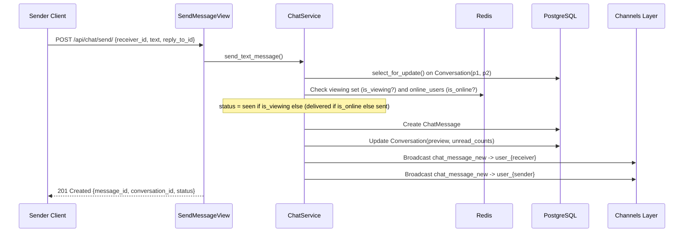

# CHAT-001 — Send Text Message

## 1. Summary
Sends a standard text message to a conversation partner via REST `POST /api/chat/send/`. Computes initial message status dynamically based on receiver presence, updates conversation denormalized fields, and broadcasts the event in real-time over WebSocket.

## 2. Context
Text messaging is the core communication medium in Pulse Chat. REST handling ensures transactional atomicity and conversation locking, while WebSocket broadcasts notify active client devices.

## 3. Scope
**In scope**
- Validation of `receiver_id` and non-empty `text`.
- Optional parent message referencing (`reply_to_id`).
- Conversation row lookup/creation with locked participant sorting (`participant_1 < participant_2`).
- Dynamic status calculation (`seen`, `delivered`, `sent`).
- Atomic update of conversation last message preview and unread counters.
- Real-time broadcast to both sender (`user_{sender}`) and receiver (`user_{receiver}`).

**Out of scope**
- Media attachments (covered in [CHAT-002](CHAT-002-media-message-upload.md)).

## 4. Behavior


## 5. Interface
- **Endpoint**: `POST /api/chat/send/` (Authenticated)
- **Request Body**:
  ```json
  {
    "receiver_id": 102,
    "text": "Hello Bob!",
    "reply_to_id": 480
  }
  ```
- **Response**: HTTP 201 Created
  ```json
  {
    "success": true,
    "message": "Message sent",
    "data": {
      "message_id": 501,
      "conversation_id": 24,
      "type": "text",
      "status": "delivered",
      "created_at": "2026-10-21T13:00:00Z"
    }
  }
  ```

## 6. Acceptance criteria
- **AC1** Given an authenticated user, valid `receiver_id`, and non-empty `text`, calling `POST /api/chat/send/` creates a `ChatMessage` row with `message_type="text"` and returns HTTP 201.
- **AC2** If the receiver currently has the chat open (`user:{receiver}:viewing:{sender}` in Redis > 0), the initial message status is `seen`.
- **AC3** If the receiver is online (`online_users` in Redis) but not viewing, initial status is `delivered`.
- **AC4** If the receiver is offline, initial status is `sent`.
- **AC5** If `reply_to_id` is supplied and references an existing message, `reply_to` is populated and `reply_metadata` contains snapshot `{id, sender_name, preview, msg_type}`.
- **AC6** The `Conversation` record is updated with `last_message_content = text`, `last_message_type = 'text'`, and if the receiver is not viewing, `unread_counts[receiver_id]` increments by 1.
- **AC7** The new message is broadcast as `chat_message_new` to both `user_{receiver_id}` and `user_{sender_id}` groups.

## 7. Non-functional requirements
- Database write executed within `@transaction.atomic` using `select_for_update()` on `Conversation` to prevent race conditions on unread counters.

## 8. Known deviations
- None.

## 9. Open questions
- None.

## 10. Changelog
| Date | Change | By |
| --- | --- | --- |
| 2026-10-21 | Initial as-built specification | Antigravity |
