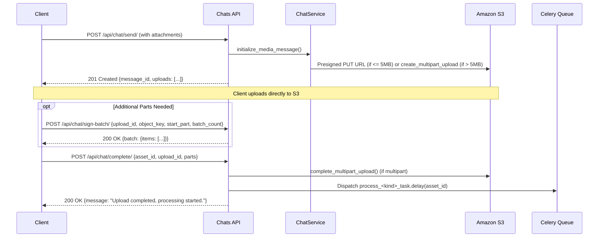

# CHAT-002 — Media Message & Direct-to-S3 Upload Pipeline

## 1. Summary
Initializes media messages (image, video, audio, file, album) by provisioning presigned S3 direct or multipart upload instructions, and upon upload completion triggers isolated asynchronous processing workers.

## 2. Context
Large media cannot be funneled through Django application worker memory without degrading system throughput. The client negotiates direct S3 upload credentials with the backend, streams bytes to cloud storage, and informs the backend when chunks are completed.

## 3. Scope
**In scope**
- Validating attachment items (`file_name`, `file_size`, `content_type`, `kind`).
- Determining message type (`image`, `video`, `audio`, `file`, or `album` if $>1$ attachment).
- Creating `ChatMessage` and child `MediaAsset(processing_status='queued')` rows.
- Generating direct `put_object` presigned URLs for items $\le$ 5 MB.
- Initializing S3 multipart uploads and generating part URLs for items $>$ 5 MB.
- Additional part batch signing (`POST /api/chat/sign-batch/`).
- Finalizing upload and enqueuing celery processing tasks (`POST /api/chat/complete/`).

**Out of scope**
- Video and image transcoding algorithms (covered in [MEDIA-001](../media/MEDIA-001-image-processing.md) and [MEDIA-002](../media/MEDIA-002-video-hls-processing.md)).

## 4. Behavior

## 5. Interface
- **Initialize Upload**: `POST /api/chat/send/` with `attachments: [...]`
- **Sign Batch**: `POST /api/chat/sign-batch/`
- **Complete Upload**: `POST /api/chat/complete/`
  - Body: `{"asset_id": 89, "upload_id": "abc...", "parts": [{"ETag": "...", "PartNumber": 1}]}`

## 6. Acceptance criteria
- **AC1** Given a send request with attachments, `ChatMessage` is created with child `MediaAsset` records having `processing_status="queued"`.
- **AC2** If attachments count is 1, `message_type` matches attachment `kind`; if count $> 1$, `message_type` is `"album"`.
- **AC3** Attachments $\le$ 5 MB receive `mode: "direct"` with a single presigned PUT URL expiring in 300 seconds.
- **AC4** Attachments $>$ 5 MB require `client_part_size` and `client_num_parts`, and receive `mode: "multipart"` with an `upload_id` and initial batch of part URLs.
- **AC5** When `POST /api/chat/sign-batch/` is called, presigned URLs for part numbers `start_part` to `start_part + batch_count` are generated and returned.
- **AC6** When `POST /api/chat/complete/` is called with valid ownership, `processing_status` transitions to `"running"` and the corresponding queue task (`process_video_task`, `process_image_task`, `process_audio_task`, or `process_file_task`) is delayed.
- **AC7** If caller is not the sender of the message owning `asset_id`, `POST /api/chat/complete/` returns HTTP 403 Forbidden.

## 7. Non-functional requirements
- Direct threshold: 5 MB. Max batch count per signing call: 500 parts. Part URL expiration: 3600 seconds.

## 8. Known deviations
- BUG-004: `sign-batch` lacks an ownership check verifying `object_key` belongs to the requesting user.
- BUG-007: `MediaAsset.url` hardcodes public S3 URL format and ignores `USE_S3_MOCK`.
- BUG-008: Views invoke `utils/aws.py` while services invoke `utils/s3.py`.
- BUG-012: Tasks reference removed `asset.processing_progress` model attribute.

## 9. Open questions
- None.

## 10. Changelog
| Date | Change | By |
| --- | --- | --- |
| 2026-10-21 | Initial as-built specification | Antigravity |
