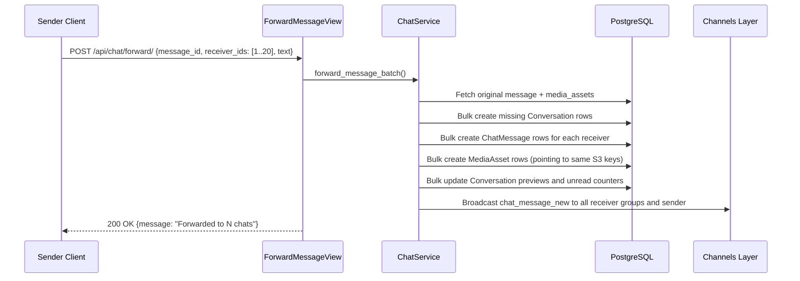

# CHAT-003 — Bulk Message Forwarding & Zero-Copy S3 Cloning

## 1. Summary
Allows a user to forward an existing message (text or media) to up to 20 recipient users in a single atomic bulk operation. Attached media assets are cloned at the database level referencing the original S3 object key with zero network byte copying.

## 2. Context
Users frequently share messages and media assets to multiple contacts. Performing individual sequential sends creates $O(N)$ HTTP calls and wastes storage if media files are re-uploaded. Bulk forwarding reuses S3 object keys and inserts messages via Django `bulk_create`.

## 3. Scope
**In scope**
- Forwarding text or media messages to 1–20 recipient user IDs.
- Optional caption override via `text` field.
- Bulk conversation lookup and creation for missing recipient threads.
- Bulk message creation with `is_forwarded=True` and `forward_source_name`.
- Zero-copy cloning of finished (`processing_status='done'`) media assets.
- Bulk update of conversation denormalized fields.
- Real-time event broadcasting to all recipient channels.

**Out of scope**
- Forwarding messages to group chats (1-to-1 chats only).

## 4. Behavior


## 5. Interface
- **Endpoint**: `POST /api/chat/forward/` (Authenticated)
- **Request Body**:
  ```json
  {
    "message_id": 501,
    "receiver_ids": [102, 105, 108],
    "text": "Check this out!"
  }
  ```
- **Response**: HTTP 200 OK
  ```json
  {
    "success": true,
    "message": "Forwarded to 3 chats",
    "data": null
  }
  ```

## 6. Acceptance criteria
- **AC1** Given a valid message ID and list of 1 to 20 receiver IDs, calling `POST /api/chat/forward/` creates forwarded messages for each recipient and returns HTTP 200.
- **AC2** Forwarded messages have `is_forwarded = True` and `forward_source_name` set to the original author's name.
- **AC3** If original message has media assets with status `"done"`, cloned `MediaAsset` records are created for each recipient with identical `object_key`, `bucket`, dimensions, and variants, with status `"done"`.
- **AC4** Unprocessed or failed media assets on the source message are excluded from cloning.
- **AC5** If `text` is provided in the request payload, it overrides the original message text content; otherwise, original content is preserved.
- **AC6** The sender's own user ID is filtered out if inadvertently included in `receiver_ids`.
- **AC7** Database operations execute within an atomic transaction using `bulk_create` and `bulk_update`.

## 7. Non-functional requirements
- Maximum batch size: 20 recipient IDs (`max_length=20`).

## 8. Known deviations
- None.

## 9. Open questions
- None.

## 10. Changelog
| Date | Change | By |
| --- | --- | --- |
| 2026-10-21 | Initial as-built specification | Antigravity |
