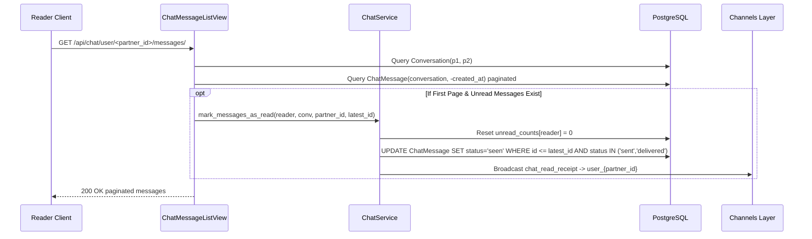

# CHAT-005 — Message History & Read Receipt Generation

## 1. Summary
Retrieves paginated message history for a conversation between the caller and a specified partner user. Opening the first page automatically resets unread counters, transitions partner messages from `sent`/`delivered` to `seen`, and dispatches real-time read receipts.

## 2. Context
When a user opens a conversation thread, they expect previous messages loaded newest-first and seamless infinite scroll backwards in time. Concurrently, reading messages must trigger read receipts to the sender.

## 3. Scope
**In scope**
- Finding or validating conversation for participant pair `sorted([user_id, partner_id])`.
- Querying `ChatMessage` ordered by `-created_at` with page size 30.
- Excluding messages sent by partner with status `failed`.
- Sanitizing media assets in response: hiding failed assets if caller is receiver, but showing failed assets if caller is author.
- Automatically executing `mark_messages_as_read` when loading the first page without a cursor.
- Emitting `chat_read_receipt` over WebSocket to partner's channel group.

**Out of scope**
- Searching within message history (future spec).

## 4. Behavior


## 5. Interface
- **Endpoint**: `GET /api/chat/user/<partner_id>/messages/?cursor=...` (Authenticated)
- **Response**: HTTP 200 OK cursor paginated
  ```json
  {
    "success": true,
    "message": "Messages retrieved successfully",
    "data": {
      "messages": [
        {
          "id": 502,
          "conversation_id": 24,
          "sender_id": 102,
          "content": "Are you available?",
          "message_type": "text",
          "status": "seen",
          "created_at": "2026-10-21T13:02:00Z",
          "is_edited": false,
          "is_forwarded": false,
          "forward_source_name": null,
          "reply_to": null,
          "reply_metadata": null,
          "asset_count": 0,
          "media_assets": [],
          "is_me": false
        }
      ],
      "next": "http://localhost:8000/api/chat/user/102/messages/?cursor=cD0yMDI2",
      "previous": null
    }
  }
  ```

## 6. Acceptance criteria
- **AC1** Calling `GET /api/chat/user/<partner_id>/messages/` returns messages in reverse chronological order (`-created_at`) with page size 30.
- **AC2** When loading the first page (no `cursor` parameter) and the top message is from `partner_id`, all messages from `partner_id` with status `sent` or `delivered` up to the top message ID are updated to status `seen`.
- **AC3** When messages are marked as read, `unread_counts[reader_id]` is reset to 0 on `Conversation` and a `chat_read_receipt` is sent to `user_{partner_id}`.
- **AC4** If the reader already has 0 unread messages, database update and WebSocket broadcast are skipped.
- **AC5** Failed media assets (`processing_status='failed'`) are stripped from `media_assets` when viewed by the recipient, but remain visible to the sender.
- **AC6** Messages sent by the partner with status `failed` are completely excluded from the thread.

## 7. Non-functional requirements
- Database query uses `select_related('reply_to')` and `prefetch_related('media_assets')` to prevent N+1 queries.

## 8. Known deviations
- BUG-005: If no conversation row exists yet between the two users, calling the view triggers an `AttributeError` on pagination resulting in HTTP 500 instead of returning an empty paginated list.
- BUG-009: `mark_messages_as_read` updates `unread_counts` without using `select_for_update()`, risking race conditions under concurrent sends.

## 9. Open questions
- None.

## 10. Changelog
| Date | Change | By |
| --- | --- | --- |
| 2026-10-21 | Initial as-built specification | Antigravity |
