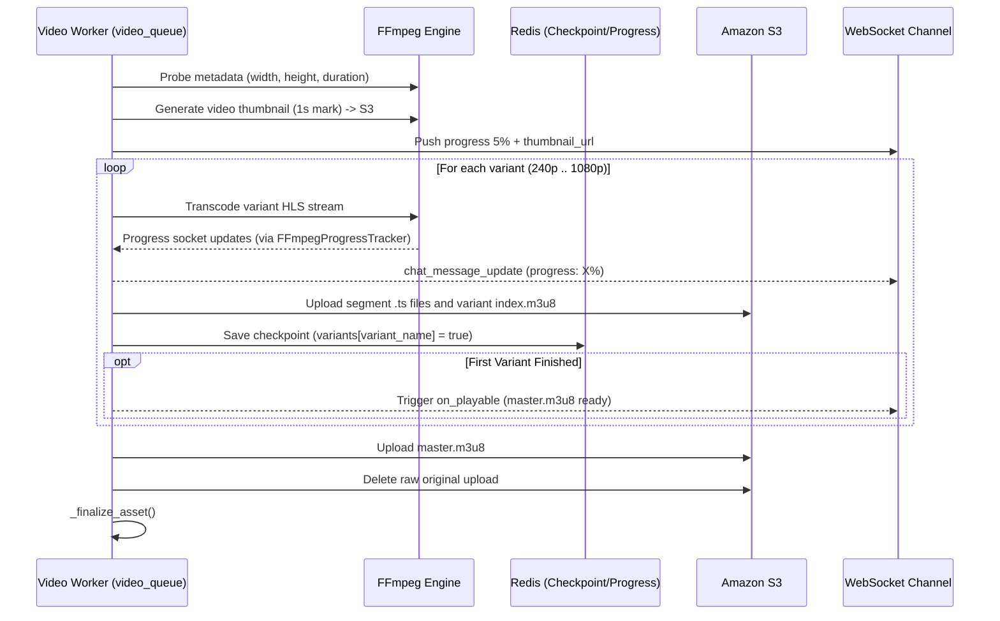

# MEDIA-002 — Asynchronous Video HLS Transcoding & Checkpointing

## 1. Summary
Transcodes raw video uploads into adaptive multi-bitrate HLS streams (`.m3u8` playlists and `.ts` segments) across a resolution ladder (`1080p`, `720p`, `480p`, `360p`, `240p`) in an isolated Celery worker (`video_queue`). Features real-time WebSocket progress reporting, resume-on-retry checkpointing via Redis, and an early "playable" event.

## 2. Context
Mobile video playback over varying network conditions requires adaptive bitrate streaming (HLS). Video processing is the most compute-heavy process in the architecture and must be isolated, interruptible, and progressive.

## 3. Scope
**In scope**
- Probing video stream via FFprobe and validating stream integrity.
- Generating early WebP video thumbnail at timestamp 1s.
- Transcoding video into HLS streams using `libx264` and `aac` with 10-second segments.
- Streaming progress updates over WebSocket via `FFmpegProgressTracker` whenever progress changes by $\ge 2\%$.
- Triggering `on_playable` callback when the lowest resolution variant completes so clients can begin playback immediately.
- Storing variant progress checkpoints in Redis (`video_checkpoint:{asset_id}`) enabling resume without re-encoding on task retry.
- Uploading master playlist and segments to S3 and deleting raw upload file.

**Out of scope**
- DRM encryption (FairPlay / Widevine).

## 4. Behavior


## 5. Interface
- **Progress Payload** (WebSocket `chat_message_update`):
  ```json
  {
    "type": "chat_message_update",
    "data": {
      "id": 505,
      "conversation_id": 24,
      "status": "sent",
      "media_assets": [
        {
          "id": 92,
          "processing_status": "running",
          "progress": 42.5,
          "thumbnail_url": "https://.../thumbnail.webp",
          "width": 1920,
          "height": 1080,
          "duration_seconds": 18.4
        }
      ]
    }
  }
  ```

## 6. Acceptance criteria
- **AC1** Task executes exclusively on `video_queue` with concurrency limited to 2 workers.
- **AC2** If the file contains no valid video stream, processing fails and errors are recorded.
- **AC3** Video dimensions and duration are attached to the asset in memory immediately after probe to avoid client UI layout shifts.
- **AC4** Real-time progress updates are emitted to the sender whenever progress increments by $\ge 2\%$.
- **AC5** When the first variant finishes encoding, `on_playable` emits an update with `master.m3u8` so client players can start streaming before higher variants finish.
- **AC6** Checkpoints for completed variants are stored in Redis; if the task is restarted or retried, completed variants are skipped.
- **AC7** Upon full completion, the master playlist is finalized with `CacheControl: max-age=31536000` and the raw video file is deleted from S3.

## 7. Non-functional requirements
- Soft time limit: 3600s; hard time limit: 3660s. Max retries: 3.
- HLS segment duration: 10 seconds (`hls_time=10`).

## 8. Known deviations
- None.

## 9. Open questions
- None.

## 10. Changelog
| Date | Change | By |
| --- | --- | --- |
| 2026-10-21 | Initial as-built specification | Antigravity |
