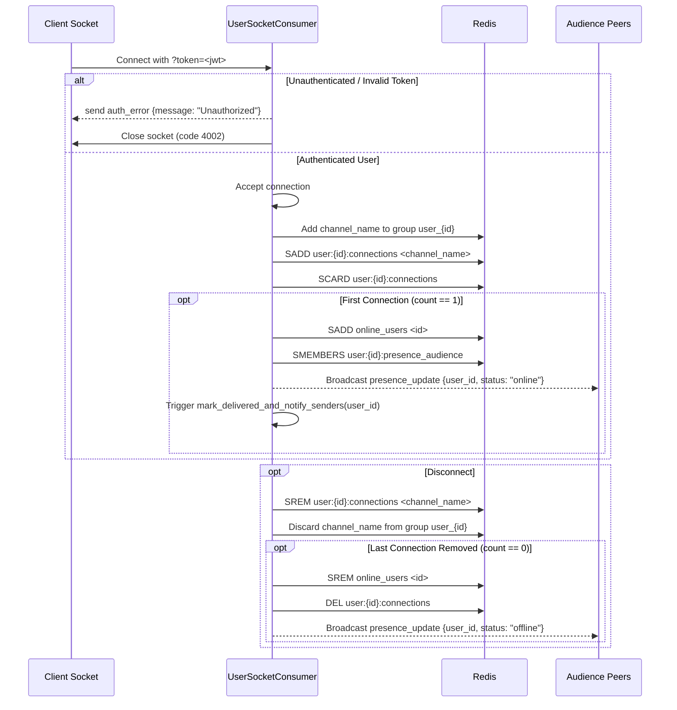

# RT-001 — WebSocket Connection & Multi-Device Presence

## 1. Summary
Manages the persistent WebSocket connection lifecycle for clients at `ws://<host>:8000/ws/chat/?token=<jwt>`. Connects user sockets to their dedicated channel group `user_{id}`, manages multi-connection presence tracking in Redis, notifies presence audience members of online/offline status, and handles keep-alive ping/pong frames.

## 2. Context
Real-time messaging requires reliable bidirectional socket connections that remain aware of whether a user is currently reachable across their phone, desktop, or multiple browser tabs without duplicate events.

## 3. Scope
**In scope**
- Authenticating connection handshake using access token from query string.
- Joining and leaving channel layer group `user_{user_id}`.
- Managing `user:{user_id}:connections` set in Redis.
- Managing global `online_users` set.
- Pushing `presence_update` to `presence_audience` on first connect (offline $\to$ online) and final disconnect (online $\to$ offline).
- Heartbeat: responding to `{"type": "ping"}` with `{"type": "pong"}`.

**Out of scope**
- Push notifications when user is completely offline (APNs / FCM).

## 4. Behavior


## 5. Interface
- **Connection URL**: `ws://<host>:8000/ws/chat/?token=<token>`
- **Ping / Pong**:
  - Inbound: `{"type": "ping"}`
  - Outbound: `{"type": "pong"}`
- **Presence Notification**:
  - Outbound:
    ```json
    {
      "type": "presence_update",
      "data": {
        "user_id": 101,
        "status": "online"
      }
    }
    ```

## 6. Acceptance criteria
- **AC1** An unauthenticated or invalid token on connect receives `{"type": "auth_error", "message": "Unauthorized"}` and the socket closes with code 4002.
- **AC2** An authenticated connection joins channel group `user_{user.id}`.
- **AC3** When a user's connection count in `user:{id}:connections` transitions from 0 to 1, user ID is added to `online_users` and `presence_update` with status `"online"` is sent to all user IDs in `user:{id}:presence_audience`.
- **AC4** When a user disconnects their last active socket, user ID is removed from `online_users`, `user:{id}:connections` is deleted, and `presence_update` with status `"offline"` is sent to their audience.
- **AC5** If a user has 2 open tabs and closes 1, connection count remains $> 0$ and no offline notification is broadcast.
- **AC6** Inbound message `{"type": "ping"}` immediately triggers outbound message `{"type": "pong"}`.

## 7. Non-functional requirements
- Connection management operations in Redis use non-blocking asynchronous calls (`redis.asyncio`).

## 8. Known deviations
- BUG-006: ASGI middleware does not verify the `client_hash` signature.

## 9. Open questions
- None.

## 10. Changelog
| Date | Change | By |
| --- | --- | --- |
| 2026-10-21 | Initial as-built specification | Antigravity |
