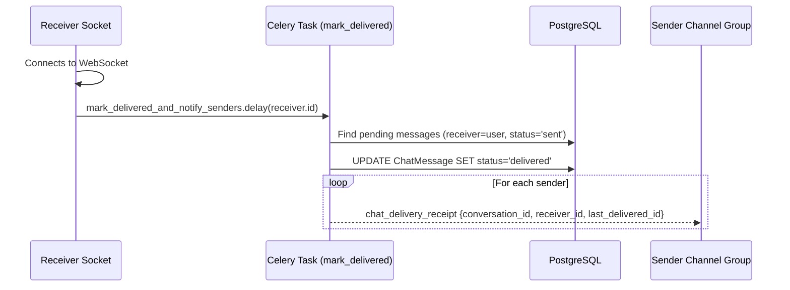

# RT-003 — Delivery & Read Receipts Notification Engine

## 1. Summary
Manages the message delivery lifecycle: batch-updating undelivered messages to `delivered` when an offline recipient connects, pushing real-time `chat_delivery_receipt` events to senders, and pushing real-time `chat_read_receipt` events when a recipient reads messages.

## 2. Context
Users require immediate visual feedback on message status (single tick: sent to server; double grey ticks: delivered to partner device; double blue ticks: read by partner).

## 3. Scope
**In scope**
- Background task `mark_delivered_and_notify_senders` triggered on user socket connect.
- Grouping undelivered messages (`status='sent'`) by sender and conversation.
- Updating status to `delivered` in bulk.
- Sending `chat_delivery_receipt` to each affected sender.
- Pushing `chat_read_receipt` when `ChatService.mark_messages_as_read()` updates messages to `seen`.

**Out of scope**
- SMS delivery confirmations.

## 4. Behavior


## 5. Interface
- **Delivery Receipt Event**:
  ```json
  {
    "type": "chat_delivery_receipt",
    "data": {
      "conversation_id": 24,
      "receiver_id": 102,
      "last_delivered_id": 502
    }
  }
  ```
- **Read Receipt Event**:
  ```json
  {
    "type": "chat_read_receipt",
    "data": {
      "conversation_id": 24,
      "reader_id": 102,
      "last_read_id": 502
    }
  }
  ```

## 6. Acceptance criteria
- **AC1** When a user establishes their first WebSocket connection, `mark_delivered_and_notify_senders.delay(user_id)` is invoked.
- **AC2** Any messages sent to that user currently in status `sent` are updated in the database to `delivered`.
- **AC3** For each distinct sender having newly delivered messages, a `chat_delivery_receipt` event is pushed to `user_{sender_id}` with the maximum message ID delivered.
- **AC4** When `mark_messages_as_read` updates messages to `seen`, a `chat_read_receipt` event is pushed to `user_{partner_id}` with `last_read_id`.
- **AC5** If no messages were transitioned during read or delivery sweeps, no redundant WebSocket receipts are emitted.

## 7. Non-functional requirements
- Direct socket notifications bypass queue delay via `_send_socket_update_directly()`.

## 8. Known deviations
- None (BUG-002 resolved: `mark_delivered_and_notify_senders` explicitly routed to `'default'` queue).

## 9. Open questions
- None.

## 10. Changelog
| Date | Change | By |
| --- | --- | --- |
| 2026-10-22 | Fix BUG-002: route mark_delivered_and_notify_senders to default queue | Antigravity |
| 2026-10-21 | Initial as-built specification | Antigravity |
