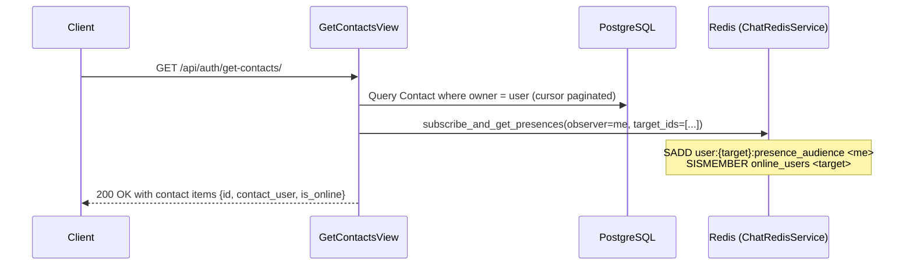

# USR-002 — Contacts Management & Presence Subscription

## 1. Summary
Allows users to add other users into their private contact list by email or username, and retrieve their contact list paginated with real-time online status and presence audience subscriptions.

## 2. Context
Users initiate direct conversations with recognized contacts. Loading the contacts list simultaneously registers the caller in the contact partners' `presence_audience` sets in Redis so status updates are pushed live.

## 3. Scope
**In scope**
- Adding contacts via identifier (`email` or `username`).
- Preventing self-addition.
- Cursor-paginated contacts listing with nested `contact_user` objects.
- Checking real-time online presence via `ChatRedisService.subscribe_and_get_presences`.

**Out of scope**
- Deleting or blocking contacts.

## 4. Behavior


## 5. Interface
- **Add Contact**: `POST /api/auth/add-contacts/`
  - Body: `{"identifier": "jane@example.com"}`
  - Response: HTTP 201 Created (or HTTP 200 if already in contacts)
- **Get Contacts**: `GET /api/auth/get-contacts/?cursor=...`
  - Response: HTTP 200 OK cursor paginated
    ```json
    {
      "success": true,
      "message": "Contacts retrieved successfully",
      "data": {
        "contacts": [
          {
            "id": 12,
            "contact_user": {
              "id": 102,
              "username": "janedoe",
              "email": "jane@example.com",
              "full_name": "Jane Doe",
              "avatar_url": null
            },
            "is_online": true
          }
        ],
        "next": null,
        "previous": null
      }
    }
    ```

## 6. Acceptance criteria
- **AC1** Given a valid email or username of an existing user, calling `add-contacts` creates a `Contact` record and returns HTTP 201.
- **AC2** Given a contact that already exists between owner and target, calling `add-contacts` returns HTTP 200 with `"Already in contacts"`.
- **AC3** Given a request where `identifier` matches the authenticated caller's own email or username, HTTP 400 is returned with `"Self-addition is not allowed"`.
- **AC4** Given an identifier matching no user, HTTP 404 is returned.
- **AC5** Given an authenticated user with contacts, calling `get-contacts` returns cursor-paginated contacts with `is_online` accurately reflecting whether target user ID is in Redis `online_users`.
- **AC6** When `get-contacts` is called, the caller ID is added to `user:{contact_id}:presence_audience` in Redis with a 7-day TTL.

## 7. Non-functional requirements
- Database constraint: `unique_together = ('owner', 'contact_user')`.
- Redis subscription queries use batched pipelining.

## 8. Known deviations
- BUG-014: View specifies `.order_by('contact_user__full_name')`, but `ContactCursorPagination` overrides it with ordering on `-created_at`.

## 9. Open questions
- None.

## 10. Changelog
| Date | Change | By |
| --- | --- | --- |
| 2026-10-21 | Initial as-built specification | Antigravity |
