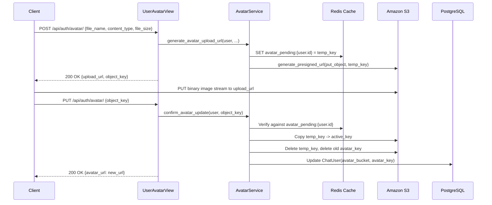

# USR-004 — User Avatar Upload & Confirmation

## 1. Summary
Enables users to upload profile pictures directly to S3 via presigned PUT URLs, and confirm the upload to copy the file to the active avatar storage path and update their user profile.

## 2. Context
Avatar uploads follow the direct-to-S3 pattern. Uploading to a temporary staging path (`avatars/temp/`) prevents unconfirmed or malicious uploads from polluting active profile paths until verified and confirmed.

## 3. Scope
**In scope**
- Validating image MIME types (`image/jpeg`, `image/png`, `image/gif`, `image/webp`) and 5MB size limit.
- Generating presigned S3 PUT URL for `avatars/temp/user_{id}_{uuid}.ext`.
- Caching pending key in Redis (`avatar_pending:{user_id}`).
- Confirmation endpoint verifying key format and ownership, copying to `avatars/active/`, deleting temp file, and updating `ChatUser.avatar_bucket` and `avatar_key`.

**Out of scope**
- Server-side image cropping (client pre-crops avatar before upload).

## 4. Behavior

## 5. Interface
- **Initialize Upload**: `POST /api/auth/avatar/`
  - Body: `{"file_name": "profile.png", "content_type": "image/png", "file_size": 1048576}`
  - Response: `{"upload_url": "<s3_url>", "object_key": "avatars/temp/user_101_abc.png"}`
- **Confirm Upload**: `PUT /api/auth/avatar/`
  - Body: `{"object_key": "avatars/temp/user_101_abc.png"}`
  - Response: `{"avatar_url": "https://chat-bucket.s3.amazonaws.com/avatars/active/user_101_abc.png"}`

## 6. Acceptance criteria
- **AC1** Given a valid image type (JPEG, PNG, GIF, WebP) under 5MB, `POST /api/auth/avatar/` returns a presigned upload URL and caches the pending key for the caller.
- **AC2** Given an unsupported MIME type (e.g. `image/svg+xml`, `application/pdf`), `POST /api/auth/avatar/` returns HTTP 400.
- **AC3** Given file size exceeding 5MB, `POST /api/auth/avatar/` returns HTTP 400.
- **AC4** Given a matching `object_key` matching the user's pending upload in cache, `PUT /api/auth/avatar/` copies the object to `avatars/active/`, deletes the temporary key, updates the user's avatar key in the database, and returns the new public URL.
- **AC5** Given an `object_key` that does not match the user's cached pending upload or fails regex validation, `PUT /api/auth/avatar/` returns HTTP 403.
- **AC6** Given an existing avatar already set for the user, confirming a new avatar deletes the prior active avatar object from S3.

## 7. Non-functional requirements
- Key validation regex: `^avatars/temp/user_\d+_[a-f0-9]+\.\w+$`.
- S3 copy and delete operations are performed using boto3.

## 8. Known deviations
- BUG-008: Uses `utils/s3.py` directly while `chats` uses `utils/aws.py`.

## 9. Open questions
- None.

## 10. Changelog
| Date | Change | By |
| --- | --- | --- |
| 2026-10-21 | Initial as-built specification | Antigravity |
